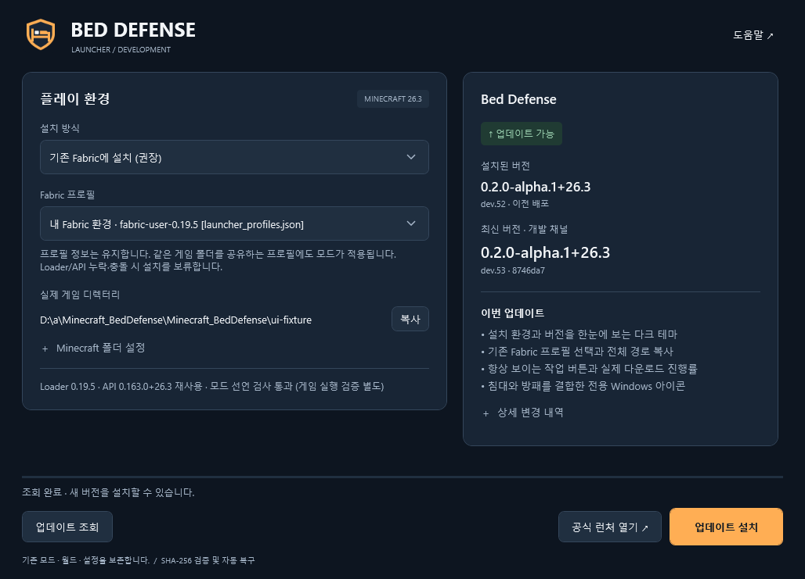
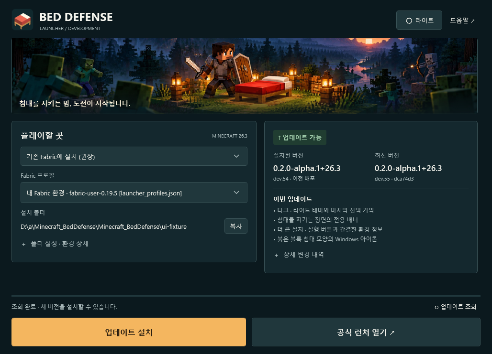
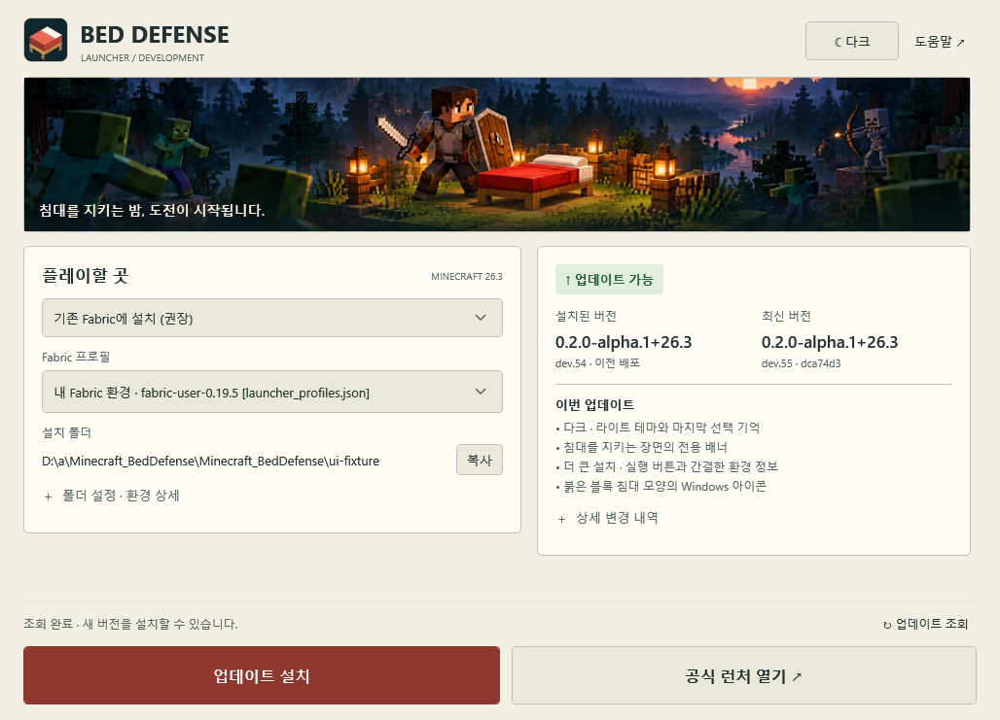
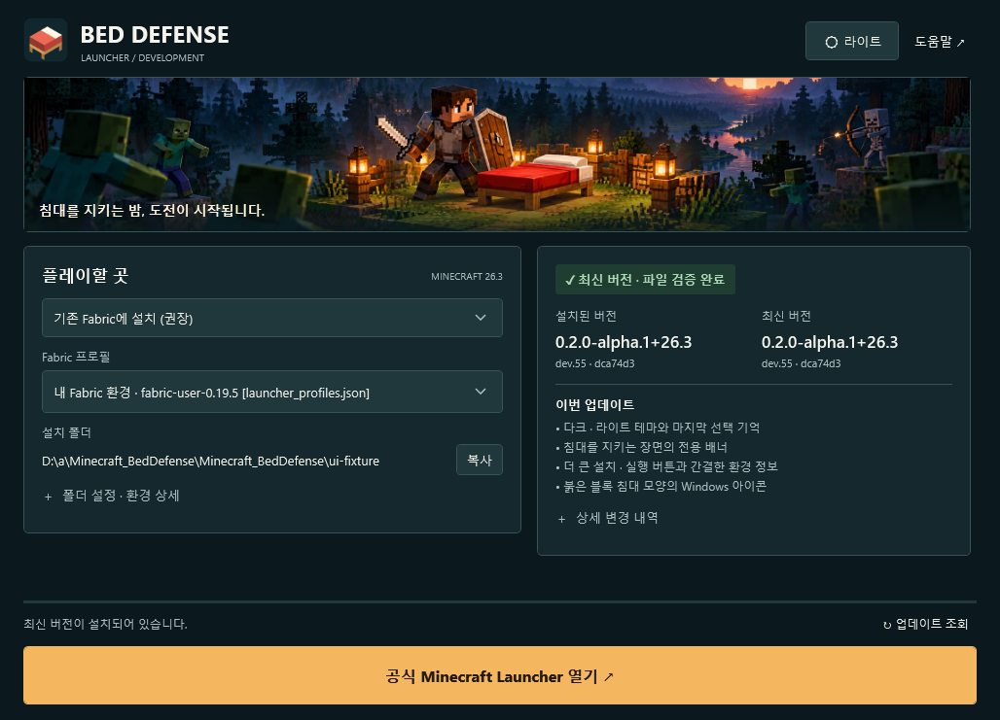
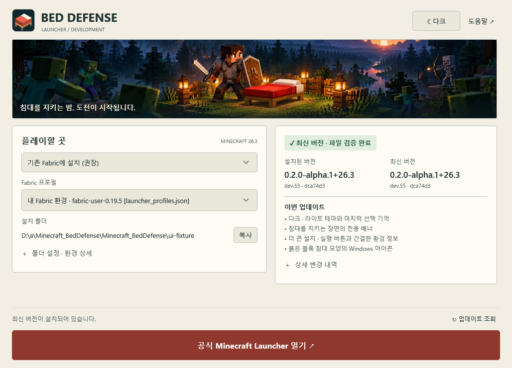
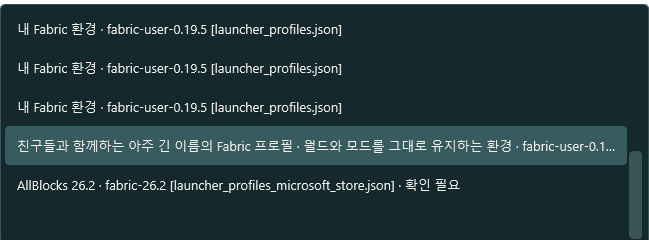
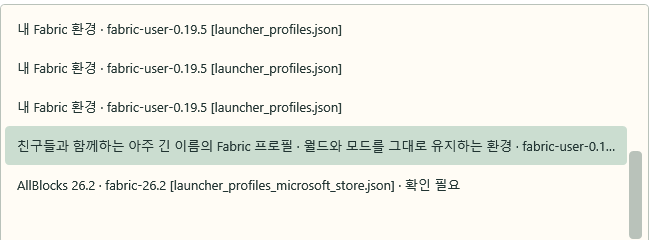

# Launcher L3 — Minecraft-inspired visual refresh

시작 main: `8746da76ec174a259a2dc73f757dc2370e95475f`.
런처 0.4.0 / Windows x64 / .NET 10 WPF. Java 게임 코드, 밸런스,
`BedDefense.Core` 설치 엔진 및 모드 버전은 변경하지 않습니다.

## 화면과 사용 흐름

- 짙은 청록·네이비 다크 테마와 따뜻한 스톤·파치먼트 라이트 테마.
- 헤더의 **라이트 / 다크** 버튼은 즉시 적용되며 수동 선택을 기억합니다.
  `%LOCALAPPDATA%/BedDefenseLauncher/appearance.json`에 원자적으로 저장합니다.
  설치 경로·프로필 설정 파일과 분리되며 파일이 없거나 손상되면 다크로 시작합니다.
  시스템 테마 자동 변경보다 사용자가 선택한 테마가 우선입니다.
- 붉은 침대를 지키는 플레이어와 접근하는 몬스터의 전용 배너.
- 기본 대상은 기존 Fabric입니다. 선택된 프로필, 실제 폴더와 버전을 보여 줍니다.
  경로는 툴팁으로 전체 확인하거나 복사할 수 있습니다.
- **폴더 설정 · 환경 상세**를 펼치면 루트 변경, 프로필 영향 설명과 호환성 결과를 확인합니다.
  오류는 접지 않고 별도 표시하며 설치를 비활성화합니다.
- 설치/업데이트와 공식 런처 열기는 높이 60 DIP의 큰 버튼입니다.
  검증된 최신 설치 상태에서는 공식 런처 열기가 가로 전체의 주 작업이 됩니다.
  버튼은 본문 스크롤 밖에 고정됩니다.
- 설치된 버전과 최신 버전을 나란히 비교합니다. 같은 모드 버전의 개발 빌드는
  `dev.N · SHA`로 구분됩니다. 요약은 실제 Release의 최대 네 개 항목만 사용합니다.
- 네이티브 Windows 제목 표시줄과 이동·최소화·최대화·닫기를 유지합니다.
  창은 작업 영역에 맞추고 좁은 폭에서는 카드를 세로로 배치합니다.

## 실제 Windows 캡처

이미지는 테스트용 상태와 격리된 Fabric 프로필을 사용해 **배포할 실제 EXE의 WPF를
Windows에서 실행한 렌더 캡처**입니다. 설치 완료·업데이트 등 상태는 검증용 fixture이며,
사용자 PC에서 실행했다고 주장하지 않습니다. 별도 HWND인 프로필 팝업도 실제로 캡처합니다.

| L2 기준 화면 | L3 다크 | L3 라이트 |
| --- | --- | --- |
|  |  |  |

최초 Windows 렌더 검토에서 넓은 창의 배너가 위쪽으로 잘려 침대가 가려지는 문제를 발견했습니다.
중앙 정렬 ImageBrush로 고치고 좁은 창의 배너 높이를 줄인 뒤 다시 캡처했습니다.
L2 기준 이미지는 main `8746da7`의 실제 업데이트 화면입니다.
L3 문서 이미지는 [PR Windows 검증 39276290806](https://github.com/darkkyoung/Minecraft_BedDefense/actions/runs/39276290806)의 실제 캡처입니다.
최종 main에서는 동일 화면과 전체 상태를 다시 캡처합니다.

| 최신 설치 · 다크 | 최신 설치 · 라이트 |
| --- | --- |
|  |  |

| 실제 프로필 팝업 · 다크 | 실제 프로필 팝업 · 라이트 |
| --- | --- |
|  |  |

테마별 전체 상태·진행률·오류·팝업·긴 변경 내역·좁은 창·배율 캡처와 `results.txt`는
최종 Actions의 `windows-validation` 아티팩트에 있습니다.

## 자동 검증 범위

기존 117개 안전성/복구 테스트와 실제 배포 번들 설치·반복 업데이트 검사를 유지합니다.
다른 모드·월드·설정·프로필 바이트 보존, 중첩 Fabric API 후보 검사, SHA-256,
실패/강제 종료 롤백, 실행 중 변경 차단, 기존/독립 설치를 그대로 검사합니다.

Windows의 단일 EXE 실행 검사:

- 다크/라이트 각각 최신 설치, 업데이트, 다운로드, 호환성 오류, 열린 프로필 목록,
  긴 변경 내역, 좁은 창, 낮은 창, 125/150/200% WPF 레이아웃 배율.
- 테마 저장 후 재읽기, 손상/미존재 설정의 안전한 기본값. 실제 사용자 설정에 접근하지 않습니다.
- 다운로드 중 테마 변경 시 진행률과 작업 잠금 보존.
- 실제 배경 리소스 전환, 텍스트/설명/주 버튼/오류 대비, 60-DIP 주 버튼과 화면 내 경계.
- 임베디드 배너 로드, 키보드 Home/Down/End 프로필 선택과 전체 경로 클립보드 복사.
- 실제 PE의 큰/작은 아이콘 추출과 WPF Window 아이콘 로드.
- 검증 단계는 불확정 진행 표시이며 가짜 퍼센트가 없습니다.
- 해시로 검증한 실제 이전 L2 EXE와 비교해 구버전 자동 재실행 차단 및 정방향 전환 허용.

main 배포에서는 공개 EXE를 다시 내려받아 SHA-256을 비교하고 실행합니다.
공개 모드 업데이트를 격리 폴더에 설치해 검증하며 실패한 Release는 숨깁니다.

## 변경 파일

- `MainWindow.xaml`, `MainWindow.Presentation.cs`: 레이아웃, CTA, 테마 전환과 네이티브 캡션.
- `MainWindow.xaml.cs`: 테마 초기화와 최신 상태의 주 버튼 열 병합만 추가.
- `Appearance.cs`, `App.xaml`, `Themes/DarkTheme.xaml`, `LightTheme.xaml`, `Launcher.xaml`:
  분리된 테마 설정과 동적 색상/공통 컨트롤 리소스.
- `Assets/BedDefense-Hero.jpg`, `BedDefense.svg`, `BedDefense.ico`, `Brand.png`:
  전용 배너와 블록 침대 아이콘. 제작 정보는 `Assets/README.md`.
- `BedDefense.Launcher.csproj`: 배너 포함 및 0.4.0 파일 버전.
- `MainWindow.Acceptance.cs`, `.github/workflows/launcher.yml`: 양쪽 테마 실행 검사,
  기존 L2 EXE를 사용하는 자체 업데이트 버전 회귀 검사.
- `launcher/release-notes.md`, README 및 이 문서: 실제 변경 내용과 검증 안내.

## 사용자 PC 최소 확인

1. 새 EXE를 받거나 기존 런처의 **런처 업데이트**를 실행합니다.
2. 헤더에서 라이트/다크를 바꾸고 종료·재실행해 선택이 유지되는지 확인합니다.
3. 기존 Fabric 26.3 프로필과 전체 설치 폴더를 확인합니다. 목록은 키보드와 스크롤로도 선택합니다.
4. 게임과 공식 런처를 종료한 뒤 **설치 / 업데이트 설치**를 누릅니다.
   기존 Sodium/Iris/AllBlocks, 월드, 설정, 프로필이 그대로인지 확인합니다.
5. **공식 런처 열기**로 선택한 Fabric 프로필을 실행합니다.
6. Windows 11의 실제 125/150% 배율과 1366×768/1920×1080에서 버튼·본문·팝업을 확인합니다.
   작업표시줄·창·탐색기의 붉은 침대 아이콘도 확인합니다.

**Physical Acceptance Pending:** CI는 Windows Server 호스트에서 실제 WPF를 실행합니다.
125/150/200% 검사는 WPF LayoutTransform 렌더링이며 모니터의 OS DPI를 바꾼 검사가 아닙니다.
Windows 11 실모니터 DPI·다중 모니터 이동·탐색기/작업표시줄 아이콘 캐시·물리 입력 체감은
사용자 PC 검증이 필요합니다. 배너는 런처용 일러스트이며 실제 게임 화면이 아닙니다.
